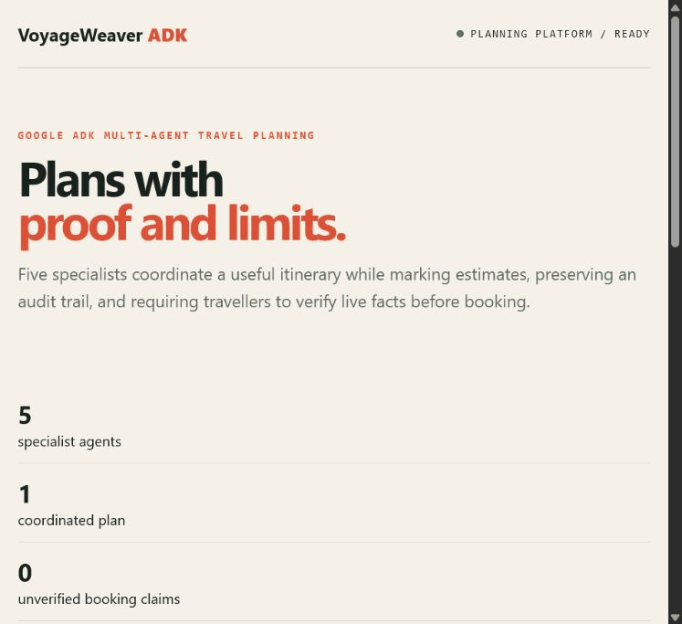

# VoyageWeaver ADK

VoyageWeaver is an original, API-first travel-planning system built with **Google Agent Development Kit for Java** and Spring Boot. A lead agent coordinates mobility, lodging, experience, travel-risk, and budget/carbon specialists, then persists the auditable result in PostgreSQL.

This is not a booking engine and never pretends that model-generated prices, availability, visa rules, or safety advice are live facts. Every plan labels estimates and gives the traveller a verification checklist.

## Product tour



[Open the full-resolution screenshot](docs/media/product-console.jpg) · **Recruiter demo:** submit an authenticated trip brief, show five-agent delegation, inspect the verification checklist, then retrieve the persisted plan.

> **Deployment status:** tested, containerized and ready for an AWS deployment with managed PostgreSQL and secrets; Gemini execution requires operator-supplied credentials and no public production endpoint is claimed yet.

## Production-oriented capabilities

- Real Google ADK multi-agent orchestration using agent-as-tool delegation
- Authenticated REST API with constant-time API-key comparison
- PostgreSQL persistence, Flyway migrations, validation and RFC 9457 errors
- Health probes and Prometheus metrics
- Non-root, read-only container and secret-only runtime configuration
- Deterministic unit tests that never spend model tokens

## Run

```bash
cp .env.example .env
docker compose up --build
```

Required environment variables: `DATABASE_PASSWORD`, `VOYAGE_API_KEY`, and `GOOGLE_API_KEY`. AI is deliberately disabled in the default local Spring profile; set `VOYAGE_AI_ENABLED=true` to activate Gemini.

```bash
curl -X POST http://localhost:8080/api/trips/plan \
  -H 'Content-Type: application/json' -H 'X-API-Key: replace-me' \
  -d '{"origin":"Chennai","destination":"Kyoto","startDate":"2026-12-01","days":7,"budget":180000,"currency":"INR","travellers":2,"interests":["food","temples"],"accessibilityNeeds":"step-free routes","sustainabilityPriority":85}'
```

## Architecture

`Client -> authenticated Spring API -> ADK coordinator -> five specialist agents -> persisted plan`

The ADK session is intentionally request-scoped; the durable business artifact is the versioned trip plan in PostgreSQL. A production deployment should place the API behind TLS/rate limiting and source secrets from its cloud secret manager.

## Verify

```bash
mvn verify
```

Designed as an original multi-agent platform with its own domain model, API, security boundary, persistence architecture, and sustainability/accessibility optimization.
